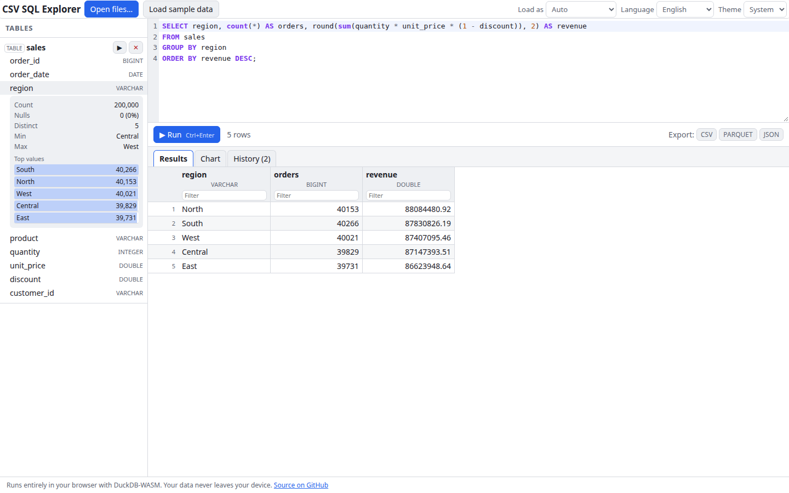

# CSV SQL Explorer

Open a CSV, TSV, Parquet, JSON or NDJSON file, even a 1 GB one, and explore it with SQL. The tool runs [DuckDB](https://duckdb.org/) compiled to WebAssembly in your browser. It shows each table's schema, profiles columns, runs your queries, and charts and exports the results. Nothing is uploaded: your data never leaves your device.

**Try it: [hermes98761234.github.io/csv-sql-explorer](https://hermes98761234.github.io/csv-sql-explorer/)**

[](https://github.com/hermes98761234/csv-sql-explorer/actions/workflows/deploy.yml)



## Features

- **Opens CSV, TSV, Parquet, JSON and NDJSON.** Use the button or drop files anywhere on the page. Files are registered by handle, so they are read in place and never copied wholesale into memory. Types are sniffed and a table is created automatically.
- **Schema sidebar with a quick profile.** Click a column for row count, nulls, distinct values, min, max and mean, plus a histogram (numbers) or top values (everything else).
- **SQL editor** (CodeMirror 6) with DuckDB-flavoured highlighting and autocompletion of table and column names. `Ctrl+Enter` (or `Cmd+Enter`) runs the script. Multiple statements are fine; the last one shows its rows.
- **Virtualized results grid.** Rows are paged in with `LIMIT`/`OFFSET`, so millions of rows scroll smoothly. Click a header to sort, type under it to filter. Sorting and filtering happen in DuckDB, not in the page.
- **Charts** of the results: bar, line or scatter, with any numeric column on Y.
- **Export** the current (sorted and filtered) results as CSV, Parquet or JSON.
- **Query history**, kept in the browser, with one-click reload or re-run.
- **Sample dataset** generated by pure SQL (`range()` plus `hash()`): 200,000 synthetic sales rows.
- **English and Ukrainian, light, dark or system theme.** Settings are remembered. Works on phones too.

## How it works

DuckDB-WASM runs in a Web Worker. The single-threaded `mvp` and `eh` bundles are imported through Vite (`?url`) and chosen at runtime with `selectBundle`. They need no `SharedArrayBuffer`, so no COOP/COEP headers: it works on GitHub Pages under a sub-path.

Opened files go through `registerFileHandle` with the browser `File`, so DuckDB reads byte ranges on demand. By default CSV and JSON are loaded into an in-memory table (fast to query, uses WASM memory, limited to about 4 GB), and Parquet is exposed as a view that reads the file in place. The **Load as** setting overrides this: choose *View* to query a very large CSV without loading it.

The results grid wraps your last statement as a subquery, `SELECT … FROM (<your query>) q WHERE … ORDER BY … LIMIT … OFFSET …`. It fetches only the blocks you scroll to. Types the Arrow bridge cannot show directly (decimals, dates, lists and so on) are cast to text in that outer query.

The SQL helpers (identifier quoting, profile queries, paging, CSV formatting) are pure functions in `src/lib/sql.ts`. Their tests include running the generated SQL against a real DuckDB.

The page and the DuckDB worker are static assets. The only large download is the DuckDB WebAssembly module (about 36 MB, 8 MB gzipped), cached by the browser after the first visit.

## Quick start

You need [Node.js](https://nodejs.org/) 22.

```bash
git clone https://github.com/hermes98761234/csv-sql-explorer.git
cd csv-sql-explorer
npm install
npm run dev       # http://localhost:5173
npm test          # SQL helper, chart, i18n and DuckDB integration tests
npm run build     # static site in dist/
```

## Limitations

- Everything lives in browser memory (WASM is capped at 4 GB), so large CSVs are best opened as a *View*.
- The tables are not persisted: reload the page and reopen your files. Query history and settings are kept.
- A file picked from disk must stay available while you work with it.

## License

MIT
